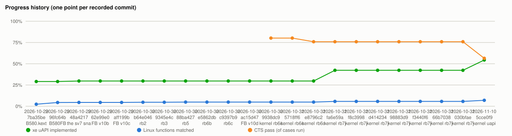

# İlerleme geçmişi / Progress history

`tools/parity/build.sh` her çalıştığında `data/history.json`'a bir satır ekler (aynı commit ve aynı sayılar tekrar yazılmaz).
Geçmiş satırlar `tools/parity/history_backfill.py` ile geliştirme deposundaki çekirdek commit'lerinden yeniden ölçüldü (commit kimlikleri o deponun, bu depoda yoklar).

Each run of `tools/parity/build.sh` appends one row; earlier rows were re-measured from the development repository's kernel commits (the commit ids are from that repository, not this one).

| Tarih / date | Commit | Etiket / label | xe uAPI | Linux fonksiyonları / functions | CTS (koşu / run) | Video çözme / decode |
|---|---|---|---|---|---|---|
| 2026-11-10 02:12 | 5cce0f9 | kernel uapi-parity: user fences, GEM_CREATE ext test | 99/182 (54.4%) | 613/8770 (7.0%) | 1772948/3145441 pass, 2026-11-04-prod9t | 26/26 bit-exact |
| 2026-10-31 16:31 | 030bfae | kernel rb7j, Mesa 7bb41ff0, ssv20, codecs-enc1 + grey cells | 77/182 (42.3%) | 497/8770 (5.7%) | 22367/29456 pass, 2026-10-30-results3 | 25/26 bit-exact |
| 2026-10-31 14:12 | 66b7038 | kernel rb7j, Mesa 7bb41ff0, ssv20, codecs-enc1 | 77/182 (42.3%) | 497/8770 (5.7%) | 22367/29456 pass, 2026-10-30-results3 | 16/16 bit-exact |
| 2026-10-31 12:56 | f3440f6 | kernel rb7j, Mesa 1edb6def, ssv15 | 77/182 (42.3%) | 497/8770 (5.7%) | 22367/29456 pass, 2026-10-30-results3 | 16/16 bit-exact |
| 2026-10-31 12:33 | 98883d9 | kernel rb7j, FB v10l, codecs-dec1 | 77/182 (42.3%) | 497/8770 (5.7%) | 22367/29456 pass, 2026-10-30-results3 | 15/16 bit-exact |
| 2026-10-31 04:51 | d414234 | kernel rb7j, FB v10l, codecs-dec1 | 77/182 (42.3%) | 497/8770 (5.7%) | 22367/29456 pass, 2026-10-30-results3 | 15/16 bit-exact |
| 2026-10-31 03:40 | f8c3998 | kernel rb7j, FB v10l | 77/182 (42.3%) | 497/8770 (5.7%) | 22367/29456 pass, 2026-10-30-results3 | 15/16 bit-exact |
| 2026-10-31 03:30 | fa6e59a | kernel rb7j, FB v10l | 77/182 (42.3%) | 497/8770 (5.7%) | 22367/29456 pass, 2026-10-30-results3 | 15/16 bit-exact |
| 2026-10-31 01:22 | e8796c2 | kernel rb6c, FB v10d | 54/182 (29.7%) | 426/8770 (4.9%) | 22367/29456 pass, 2026-10-30-results3 | 15/16 bit-exact |
| 2026-10-31 00:56 | 5718ff6 | kernel rb6c, FB v10d | 54/182 (29.7%) | 426/8752 (4.9%) | 19017/23708 pass, 2026-10-29-shards-g1-g7 | 15/16 bit-exact |
| 2026-10-30 23:07 | 9938dc9 | kernel rb6c, FB v10d | 54/182 (29.7%) | 426/8752 (4.9%) | 19017/23708 pass, 2026-10-29-shards-g1-g7 | 15/16 bit-exact |
| 2026-10-30 12:23 | ac15d47 | FB v10d | 54/182 (29.7%) | 426/8752 (4.9%) | — | — |
| 2026-10-30 12:23 | c9397b9 | rb6c | 54/182 (29.7%) | 426/8752 (4.9%) | — | — |
| 2026-10-30 12:23 | e5862db | rb6b | 54/182 (29.7%) | 426/8752 (4.9%) | — | — |
| 2026-10-30 12:23 | 88ba427 | rb5 | 54/182 (29.7%) | 426/8752 (4.9%) | — | — |
| 2026-10-30 12:23 | 9345e4c | rb3 | 54/182 (29.7%) | 411/8752 (4.7%) | — | — |
| 2026-10-30 12:22 | b64e046 | rb2 | 54/182 (29.7%) | 411/8752 (4.7%) | — | — |
| 2026-10-29 16:42 | aff199b | FB v10c | 54/182 (29.7%) | 393/8752 (4.5%) | — | — |
| 2026-10-29 16:42 | 62e99e0 | FB v10b | 54/182 (29.7%) | 393/8752 (4.5%) | — | — |
| 2026-10-29 16:42 | 48a4217 | the sv7 snapshot | 54/182 (29.7%) | 393/8752 (4.5%) | — | — |
| 2026-10-29 04:00 | 96fc64b | B580FB | 53/182 (29.1%) | 387/8752 (4.4%) | — | — |
| 2026-10-29 04:00 | 7ba35be | B580.kext | 53/182 (29.1%) | 211/8752 (2.4%) | — | — |
